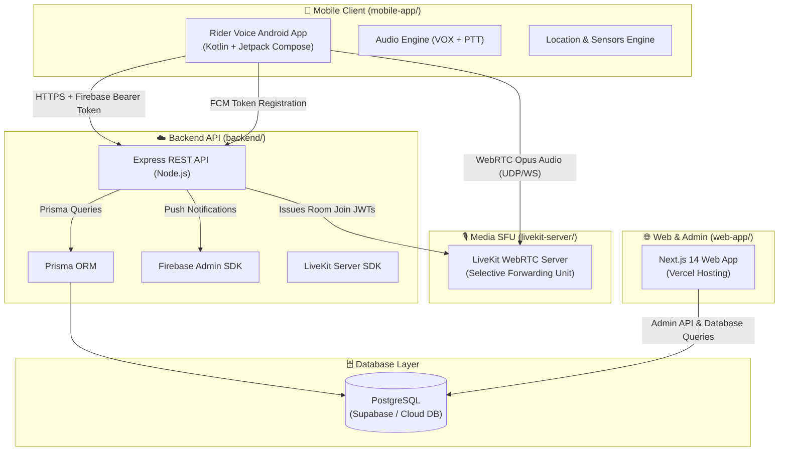
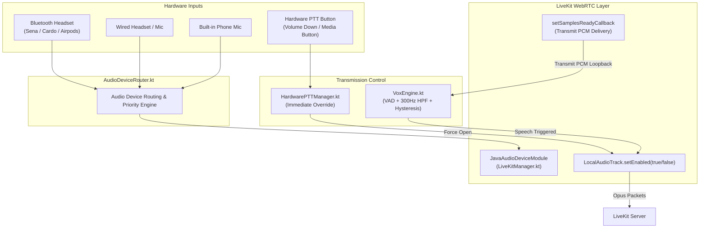
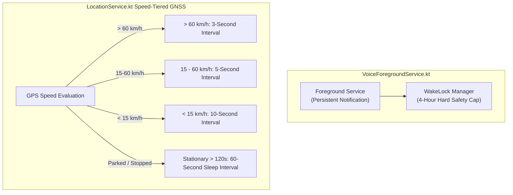
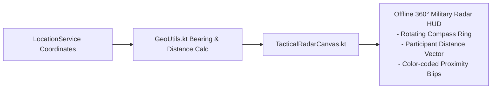
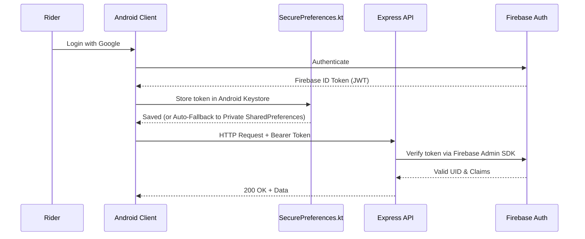
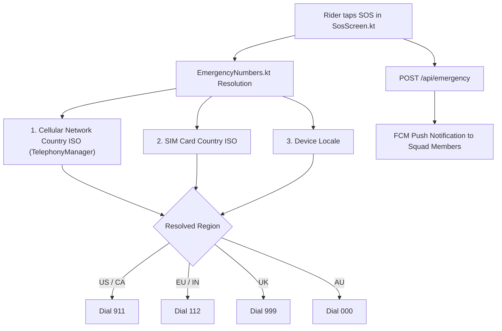
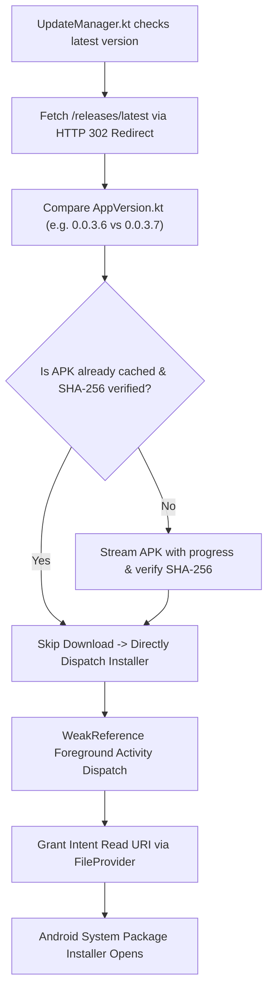
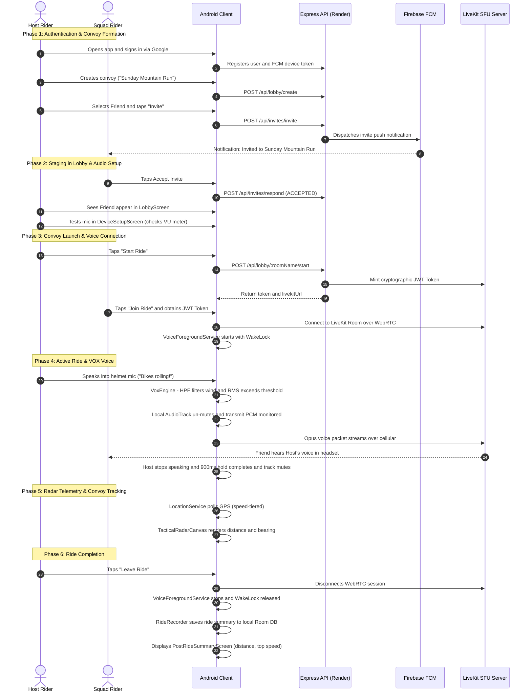

# RiderVoice: The Complete Architectural & Structural Guide

This document is designed as the definitive handbook for **RiderVoice**. It explains the **Why**, **What**, and **How** of every layer, subsystem, and file in the repository so that you can explain it to any newcomer, engineer, or stakeholder.

---

## Table of Contents
1. [The "Why": The Problem RiderVoice Solves](#1-the-why-the-problem-ridervoice-solves)
2. [The "What": High-Level System Architecture](#2-the-what-high-level-system-architecture)
3. [The "How": Deep Dive into the Core Technical Engines](#3-the-how-deep-dive-into-the-core-technical-engines)
   - [3.1 Voice & Audio Pipeline (WebRTC + VOX + PTT)](#31-voice--audio-pipeline-webrtc--vox--ptt)
   - [3.2 Foreground Services & Battery Management](#32-foreground-services--battery-management)
   - [3.3 Navigation & Offline Radar Engine](#33-navigation--offline-radar-engine)
   - [3.4 Security, Auth & Self-Healing Storage](#34-security-auth--self-healing-storage)
   - [3.5 Regional SOS Emergency Dispatch](#35-regional-sos-emergency-dispatch)
   - [3.6 Loop-Proof In-App OTA Updater](#36-loop-proof-in-app-ota-updater)
4. [Complete Repository & File Structure Map](#4-complete-repository--file-structure-map)
   - [4.1 Root Directory & Configuration](#41-root-directory--configuration)
   - [4.2 CI/CD Automation (.github/workflows/)](#42-cicd-automation-githubworkflows)
   - [4.3 Android Client (mobile-app/)](#43-android-client-mobile-app)
   - [4.4 Backend API Service (backend/)](#44-backend-api-service-backend)
   - [4.5 Voice Media Server (livekit-server/)](#45-voice-media-server-livekit-server)
   - [4.6 Web App & Admin Dashboard (web-app/)](#46-web-app--admin-dashboard-web-app)
5. [End-to-End Lifecycle Walkthrough (Rider Journey)](#5-end-to-end-lifecycle-walkthrough-rider-journey)
6. [Summary Checklist for Newcomers](#summary-checklist-for-newcomers)

---

## 1. The "Why": The Problem RiderVoice Solves

### The Real-World Physics of Motorcycling
Motorcycling presents severe technological challenges that ordinary consumer smartphone apps cannot handle:

1. **Wind Noise & Extreme Acoustic Turbulence:**
   - At highway speeds (80–130 km/h), helmet ambient noise levels reach **90 to 105 dB SPL**.
   - Standard consumer VoIP apps (Discord, WhatsApp, phone calls) operate in full-duplex mode: they keep the microphone permanently hot, broadcasting continuous wind roaring to everyone in the group, drowning out human speech, and draining cellular data.
2. **Physical Constraints & Safety:**
   - Riders wear thick leather or Kevlar gloves. They cannot look down at a phone mount or tap capacitive touchscreens while cornering or riding at speed.
   - Traditional voice apps require tapping buttons on screens or fiddling with UI menus to talk.
3. **Severe Flaws in Existing Solutions:**
   - **Bluetooth Helmet Intercoms (Sena, Cardo, Midland):**
     - *Range limitation:* Rely on local radio frequencies (Bluetooth/DMC Mesh) with a real-world range of 0.5 to 1.2 km line-of-sight. When riders separate around mountain bends, behind hills, or in dense city traffic, connection is immediately severed.
     - *Proprietary Lock-in:* A Sena user cannot seamlessly mesh with a Cardo or Lexin user without clumsy Bluetooth universal pairing bridges that degrade audio quality.
     - *High Cost:* Hardware units cost $300 to $500 per helmet.
   - **Discord / WhatsApp / Cellular Calls:**
     - *Lack of PTT/VOX:* Open-mic broadcasts engine and wind roar.
     - *No Convoy Context:* Zero live radar, no distance telemetry, no lost-rider tracking, and no group emergency routing.
     - *Aggressive Android Battery Killer Kills:* Standard apps get put to sleep by aggressive OEM power managers (Samsung, Xiaomi, OnePlus) when the screen is off for more than 10 minutes.

### The RiderVoice Solution
**RiderVoice** bridges smartphones, Bluetooth helmet headsets, cellular networks, and WebRTC:
- **Unlimited Range:** Connects riders over 4G/5G cellular via a central low-latency WebRTC Selective Forwarding Unit (SFU). As long as riders have cellular signal, range is infinite.
- **Smart Hands-Free VOX & Hardware PTT:** An intelligent Voice Activity Detection (VAD) engine with a 300Hz high-pass filter that ignores engine rumble and highway wind roar, opening only on human vocal cord frequencies and holding open for 900 ms before cleanly cutting off.
- **Tactical Convoy Radar:** An offline-capable 360° radar canvas that displays the distance, bearing, and speed of every convoy member without relying on heavy satellite maps.
- **Dynamic Regional SOS:** Instant emergency distress dispatch that resolves whether the rider is in the US (911), Europe/India (112), UK (999), or Australia (000) using SIM and network ISO codes.
- **Zero-Friction In-App Updates:** A self-healing OTA update system allowing riders to update the APK on the road without Google Play Store friction.

---

## 2. The "What": High-Level System Architecture

RiderVoice consists of four core interacting tiers:



### The 4 Core Subsystems
1. **Android Client (`mobile-app/`):**
   - Built with **Kotlin**, **Jetpack Compose**, **Hilt (Dependency Injection)**, **Coroutines & Flows**, **Room Local Database**, **Mapbox Maps SDK**, and the **LiveKit Android WebRTC SDK**.
   - Runs a dedicated Android Foreground Service with an acquire-capped `PARTIAL_WAKE_LOCK` to keep the audio stream and GPS active while the screen is locked inside a pocket or tank bag.
2. **Backend API (`backend/`):**
   - Built with **Node.js**, **Express**, **Prisma ORM**, and **Firebase Admin SDK**.
   - Deployed on **Render.com**.
   - Serves as the identity, authorization, convoy matchmaking, and LiveKit cryptographic token minting authority.
3. **Voice SFU Media Server (`livekit-server/`):**
   - High-performance WebRTC Selective Forwarding Unit (SFU) written in Go.
   - Forwards Opus voice packets directly between convoy participants with sub-150ms glass-to-glass latency without mixing audio tracks on the server.
4. **Web App & Admin Console (`web-app/`):**
   - Built with **Next.js 14 (App Router)**, **TypeScript**, and **Tailwind CSS**.
   - Deployed on **Vercel**. Provides the public marketing landing page, early-access waitlist, and an operational dashboard for convoy tracking and user management.

---

## 3. The "How": Deep Dive into the Core Technical Engines

### 3.1 Voice & Audio Pipeline (WebRTC + VOX + PTT)
The voice pipeline is the most critical subsystem in RiderVoice. It balances low latency, noise rejection, and Android Audio HAL stability.



#### Why it's designed this way:
On Android, having two independent audio recording loops (e.g., one `AudioRecord` for silence monitoring and WebRTC's own Audio Device Module for transmitting) accessing the same microphone hardware simultaneously creates a **Hardware Abstraction Layer (HAL) resource contention crash**.
Furthermore, once transmission starts, local `AudioRecord` capture must stop so WebRTC can own the microphone.

#### How it works step-by-step:
1. **Idle State (Monitoring Silence):**
   - [LiveKitManager.kt](file:///c:/Users/umerz/OneDrive/Desktop/Rider_APP-main/Rider_APP-main/mobile-app/app/src/main/java/com/ridervoice/network/LiveKitManager.kt) publishes an audio track once upon room entry, but immediately sets `track.setEnabled(false)` (muted).
   - [VoxEngine.kt](file:///c:/Users/umerz/OneDrive/Desktop/Rider_APP-main/Rider_APP-main/mobile-app/app/src/main/java/com/ridervoice/audio/VoxEngine.kt) runs a low-overhead background PCM listener (`AudioRecord`) running a **300Hz High-Pass Filter (HPF)**. Low-frequency exhaust thumps and wind buffet (<300 Hz) are filtered out before reaching the Root-Mean-Square (RMS) speech calculation.
2. **Triggering Speech:**
   - When the rider speaks, speech energy exceeds the opening threshold (e.g., `-32 dBFS`).
   - `VoxEngine` signals `LiveKitManager.kt` to un-mute the track (`track.setEnabled(true)`).
   - The idle `AudioRecord` loop is paused to release the microphone hardware completely to WebRTC.
3. **The LiveKit ADM Transmit PCM Callback (`VOX-CUT-1` & `VOX-CUT-2` Resolution):**
   - To keep measuring the rider's voice while WebRTC owns the microphone, [LiveKitManager.kt](file:///c:/Users/umerz/OneDrive/Desktop/Rider_APP-main/Rider_APP-main/mobile-app/app/src/main/java/com/ridervoice/network/LiveKitManager.kt) wires WebRTC's `JavaAudioDeviceModule.setSamplesReadyCallback`.
   - Every audio frame transmitted to WebRTC is mirrored back to `VoxEngine.onTxFrame(pcmData)`.
   - `VoxEngine` calculates RMS levels on this live stream in real time.
4. **Hysteresis & 900ms Hold Time:**
   - To prevent clipping the ends of words or sentences when a rider pauses to breathe, the closing threshold is lower than the opening threshold (hysteresis).
   - Once RMS drops below the closing threshold, `VoxEngine` holds the channel open for **900 ms**.
   - If the rider speaks again within 900 ms, transmission continues seamlessly without stutter.
   - If 900 ms elapses without speech, `track.setEnabled(false)` is invoked and `AudioRecord` monitoring resumes.
5. **Hardware PTT Mode:**
   - [HardwarePTTManager.kt](file:///c:/Users/umerz/OneDrive/Desktop/Rider_APP-main/Rider_APP-main/mobile-app/app/src/main/java/com/ridervoice/audio/HardwarePTTManager.kt) listens for hardware volume button long-presses or Bluetooth headset media button events.
   - Pressing PTT instantly forces the channel open; releasing it instantly closes it, completely overriding VOX.

---

### 3.2 Foreground Services & Battery Management
Smartphones mounted on motorcycle handlebars endure direct sunlight, engine vibration, and high thermal loads. In pockets, phones are throttled by Android's Doze mode.



1. **Foreground Service Lifecycle:**
   - [VoiceForegroundService.kt](file:///c:/Users/umerz/OneDrive/Desktop/Rider_APP-main/Rider_APP-main/mobile-app/app/src/main/java/com/ridervoice/services/VoiceForegroundService.kt) promotes the application to `FOREGROUND_SERVICE_TYPE_MICROPHONE` and `FOREGROUND_SERVICE_TYPE_LOCATION`.
   - It displays an interactive collapsed/expanded notification with live convoy status, active speakers, and instant Leave Ride controls.
2. **4-Hour WakeLock Hard Cap:**
   - Acquiring a raw `PARTIAL_WAKE_LOCK` indefinitely can drain a phone's battery overnight if a rider forgets to end a ride.
   - The service enforces a hard **4-hour timeout cap** on WakeLock acquisition. If the ride is still active, the watchdog evaluates motion before safely refreshing.
3. **Speed-Tiered GPS Polling:**
   - In [LocationService.kt](file:///c:/Users/umerz/OneDrive/Desktop/Rider_APP-main/Rider_APP-main/mobile-app/app/src/main/java/com/ridervoice/services/LocationService.kt), standard continuous 1-second GPS polling is replaced with dynamic speed tiers:
     - **Highway (> 60 km/h):** Poll every **3 seconds** (high precision for convoy radar).
     - **City Riding (15 – 60 km/h):** Poll every **5 seconds**.
     - **Crawling / Traffic (< 15 km/h):** Poll every **10 seconds**.
     - **Stationary / Coffee Stop (> 120s at 0 km/h):** Throttles down to **60 seconds**, saving up to 65% battery consumption when parked.

---

### 3.3 Navigation & Offline Radar Engine



- When riding through remote canyons or mountain passes, cellular coverage often drops to 2G or zero bars, causing Mapbox and Google Maps vector tile rendering to fail.
- **Offline Radar Canvas:**
  - [TacticalRadarCanvas.kt](file:///c:/Users/umerz/OneDrive/Desktop/Rider_APP-main/Rider_APP-main/mobile-app/app/src/main/java/com/ridervoice/ui/components/TacticalRadarCanvas.kt) provides a vector-based, mathematical 360° circular radar sweep that requires **zero map tiles and zero internet**.
  - Using [GeoUtils.kt](file:///c:/Users/umerz/OneDrive/Desktop/Rider_APP-main/Rider_APP-main/mobile-app/app/src/main/java/com/ridervoice/utils/GeoUtils.kt), it calculates the relative distance (meters) and bearing (degrees) of each convoy rider relative to the host's heading and draws directional blips on the HUD.

---

### 3.4 Security, Auth & Self-Healing Storage



1. **Identity & Authentication:**
   - Identity is verified via Firebase Authentication (Google Sign-In or phone authentication).
   - Every HTTP call from the Android app passes the Firebase ID token in the `Authorization: Bearer <token>` header.
   - The backend never trusts client IDs; it verifies cryptographic signatures using [firebaseAdmin.js](file:///c:/Users/umerz/OneDrive/Desktop/Rider_APP-main/Rider_APP-main/backend/src/config/firebaseAdmin.js).
2. **Self-Healing Storage (`AEADBadTagException` Fallback):**
   - On Android devices (particularly Samsung and Xiaomi devices after OS updates), the hardware Keystore can corrupt master keys, throwing fatal `KeyStoreException` or `AEADBadTagException` on launch, causing apps to crash loop.
   - [SecurePreferences.kt](file:///c:/Users/umerz/OneDrive/Desktop/Rider_APP-main/Rider_APP-main/mobile-app/app/src/main/java/com/ridervoice/security/SecurePreferences.kt) wraps `EncryptedSharedPreferences` in an automated recovery block: if cryptographic tag verification fails, it cleans corrupted keys and gracefully falls back to private sandboxed `SharedPreferences`, completely preventing crash loops.

---

### 3.5 Regional SOS Emergency Dispatch
When a crash or breakdown occurs, a rider cannot guess or remember the local emergency number while touring in a foreign country or state.



- [EmergencyNumbers.kt](file:///c:/Users/umerz/OneDrive/Desktop/Rider_APP-main/Rider_APP-main/mobile-app/app/src/main/java/com/ridervoice/utils/EmergencyNumbers.kt) inspects three levels of device telephony:
  1. Cellular Network Country ISO (`telephonyManager.networkCountryIso`)
  2. SIM Card Country ISO (`telephonyManager.simCountryIso`)
  3. System Locale country code
- Automatically resolves the local emergency dispatch number (911 for US/Canada, 112 for EU/India, 999 for UK, 000 for Australia, etc.).
- Simultaneously, [emergencyRoutes.js](file:///c:/Users/umerz/OneDrive/Desktop/Rider_APP-main/Rider_APP-main/backend/src/routes/emergencyRoutes.js) logs an `EmergencyAlert` record and broadcasts high-priority push notifications with GPS coordinates to the rider's squad.

---

### 3.6 Loop-Proof In-App OTA Updater
Riders installing releases from GitHub APKs without the Play Store need a seamless update mechanism that avoids OS-level installation loops.



- [UpdateManager.kt](file:///c:/Users/umerz/OneDrive/Desktop/Rider_APP-main/Rider_APP-main/mobile-app/app/src/main/java/com/ridervoice/update/UpdateManager.kt) queries GitHub's `/releases/latest` endpoint.
- **SHA-256 Checksum Validation:** Ensures corrupted or truncated cellular downloads are never passed to the system installer.
- **Local Cache Bypass:** If the APK has already been downloaded and verified, it bypasses the 55MB network download immediately.
- **Foreground Activity Anchoring:** Android 10+ restricts launching activities from background services. `UpdateManager` tracks the active `Activity` via `WeakReference`, ensuring package installer intents are never dropped by OEM background limits.

---

## 4. Complete Repository & File Structure Map

```text
Rider_APP/
├── .github/workflows/                 Continuous Integration and Release pipelines
├── backend/                           Express REST API & Prisma database layer
├── livekit-server/                    LiveKit WebRTC SFU configuration
├── mobile-app/                        Android client application module
├── web-app/                           Next.js public site & admin dashboard
├── ARCHITECTURE.md                    High-level system diagrams and decisions
├── CODE_DEPTH_STRUCTURE.md            File-level code map
├── PROJECT_ROADMAP_AND_TASKS.md       Master engineering task and roadmap tracker
├── README.md                          Product overview and developer quickstart
├── RELEASE_NOTES.md                   Changelog across versions
└── render.yaml                        Render.com deployment manifest for backend
```

---

### 4.1 Root Directory & Configuration

| File | Why it exists | What it contains | How it works |
| :--- | :--- | :--- | :--- |
| [ARCHITECTURE.md](file:///c:/Users/umerz/OneDrive/Desktop/Rider_APP-main/Rider_APP-main/ARCHITECTURE.md) | High-level engineering reference | Architecture diagrams, subsystem descriptions, data flow models | Document detailing core system contracts and decisions. |
| [CODE_DEPTH_STRUCTURE.md](file:///c:/Users/umerz/OneDrive/Desktop/Rider_APP-main/Rider_APP-main/CODE_DEPTH_STRUCTURE.md) | File-level codebase index | Comprehensive inventory of directories, source files, and responsibilities | Quick-lookup guide for engineers locating where specific features reside. |
| [PROJECT_ROADMAP_AND_TASKS.md](file:///c:/Users/umerz/OneDrive/Desktop/Rider_APP-main/Rider_APP-main/PROJECT_ROADMAP_AND_TASKS.md) | Project task and sprint tracker | Completed tasks, backlog items, testing matrices, and status checkboxes | Tracks development progress across audio fixes, battery optimizations, and UI cleanups. |
| [README.md](file:///c:/Users/umerz/OneDrive/Desktop/Rider_APP-main/Rider_APP-main/README.md) | Developer onboarding guide | Overview of the app, prerequisites, environment setup, and local run instructions | Entry point for new contributors cloning the repository. |
| [RELEASE_NOTES.md](file:///c:/Users/umerz/OneDrive/Desktop/Rider_APP-main/Rider_APP-main/RELEASE_NOTES.md) | Public version changelog | Detailed release history (`v0.0.3.0` through `v0.0.3.7`) | Documents fixes, new features, and changes for each release. |
| [render.yaml](file:///c:/Users/umerz/OneDrive/Desktop/Rider_APP-main/Rider_APP-main/render.yaml) | Cloud infrastructure specification | Blueprint deploying the backend service on Render.com | Provisions Node.js web service, environment variable references, and build commands. |

---

### 4.2 CI/CD Automation (`.github/workflows/`)

| File | Why it exists | What it contains | How it works |
| :--- | :--- | :--- | :--- |
| [build.yml](file:///c:/Users/umerz/OneDrive/Desktop/Rider_APP-main/Rider_APP-main/.github/workflows/build.yml) | Continuous integration gate | Runs on every PR and push to `main` | Sets up JDK 17, builds Android debug APK (`assembleDebug`), and runs unit test suites (`testDebugUnitTest`). |
| [release.yml](file:///c:/Users/umerz/OneDrive/Desktop/Rider_APP-main/Rider_APP-main/.github/workflows/release.yml) | Automated release pipeline | Triggers when a git tag (e.g. `v*.*.*.*`) is pushed | Compiles signed release APK, generates SHA-256 checksum, and creates an official GitHub Release with downloadable assets. |

---

### 4.3 Android Client (`mobile-app/`)

Located at: `mobile-app/app/src/main/java/com/ridervoice/`

#### 4.3.1 Application Entry & Lifecycle
- [App.kt](file:///c:/Users/umerz/OneDrive/Desktop/Rider_APP-main/Rider_APP-main/mobile-app/app/src/main/java/com/ridervoice/App.kt): Application class annotated with `@HiltAndroidApp`. Initializes Timber/Logger, creates Android notification channels for voice and messaging, and bootstraps the dependency graph.
- [MainActivity.kt](file:///c:/Users/umerz/OneDrive/Desktop/Rider_APP-main/Rider_APP-main/mobile-app/app/src/main/java/com/ridervoice/MainActivity.kt): The single Activity in the app. Hosts the Jetpack Compose surface, observes global navigation events, registers lifecycle callbacks for [UpdateManager.kt](file:///c:/Users/umerz/OneDrive/Desktop/Rider_APP-main/Rider_APP-main/mobile-app/app/src/main/java/com/ridervoice/update/UpdateManager.kt), and handles hardware button events.

#### 4.3.2 Audio Engine (`audio/`)
- [AudioDeviceRouter.kt](file:///c:/Users/umerz/OneDrive/Desktop/Rider_APP-main/Rider_APP-main/mobile-app/app/src/main/java/com/ridervoice/audio/AudioDeviceRouter.kt): Manages routing between Bluetooth SCO/A2DP, wired 3.5mm/USB-C headsets, and the device loudspeaker.
- [AudioFocusManager.kt](file:///c:/Users/umerz/OneDrive/Desktop/Rider_APP-main/Rider_APP-main/mobile-app/app/src/main/java/com/ridervoice/audio/AudioFocusManager.kt): Manages Android `AudioManager.requestAudioFocus` to duck music or navigation prompts during active rider speech.
- [HardwarePTTManager.kt](file:///c:/Users/umerz/OneDrive/Desktop/Rider_APP-main/Rider_APP-main/mobile-app/app/src/main/java/com/ridervoice/audio/HardwarePTTManager.kt): Intercepts physical headset buttons or volume rocker long-presses to toggle push-to-talk transmission.
- [VoxEngine.kt](file:///c:/Users/umerz/OneDrive/Desktop/Rider_APP-main/Rider_APP-main/mobile-app/app/src/main/java/com/ridervoice/audio/VoxEngine.kt): Core Voice Activity Detection engine. Runs the 300Hz high-pass filter, calculates RMS values, receives transmit frames via `onTxFrame()`, and manages the 900ms hold timer.
- [VoxDetector.kt](file:///c:/Users/umerz/OneDrive/Desktop/Rider_APP-main/Rider_APP-main/mobile-app/app/src/main/java/com/ridervoice/audio/VoxDetector.kt): Math utility for computing decibel levels, signal noise floors, and sample-level threshold comparisons.
- [LocalMeshVoiceEngine.kt](file:///c:/Users/umerz/OneDrive/Desktop/Rider_APP-main/Rider_APP-main/mobile-app/app/src/main/java/com/ridervoice/audio/LocalMeshVoiceEngine.kt) & [WifiDirectManager.kt](file:///c:/Users/umerz/OneDrive/Desktop/Rider_APP-main/Rider_APP-main/mobile-app/app/src/main/java/com/ridervoice/audio/WifiDirectManager.kt): Wi-Fi Direct P2P fallback when cellular coverage is unavailable.

#### 4.3.3 Foreground Services & Background Monitoring (`services/`)
- [VoiceForegroundService.kt](file:///c:/Users/umerz/OneDrive/Desktop/Rider_APP-main/Rider_APP-main/mobile-app/app/src/main/java/com/ridervoice/services/VoiceForegroundService.kt): Persistent Android service keeping WebRTC audio alive with an acquire-capped `PARTIAL_WAKE_LOCK`.
- [LocationService.kt](file:///c:/Users/umerz/OneDrive/Desktop/Rider_APP-main/Rider_APP-main/mobile-app/app/src/main/java/com/ridervoice/services/LocationService.kt): Gathers GNSS coordinates with speed-tiered polling (>60km/h: 3s, 15-60km/h: 5s, <15km/h: 10s, stationary >120s: 60s).
- [RideRecorder.kt](file:///c:/Users/umerz/OneDrive/Desktop/Rider_APP-main/Rider_APP-main/mobile-app/app/src/main/java/com/ridervoice/services/RideRecorder.kt): Records trip breadcrumbs, speeds, and timestamps to the local database for post-ride review.
- [FcmService.kt](file:///c:/Users/umerz/OneDrive/Desktop/Rider_APP-main/Rider_APP-main/mobile-app/app/src/main/java/com/ridervoice/services/FcmService.kt): Receives Firebase Cloud Messaging push events (convoy invitations, ride start alerts, emergency SOS dispatch).
- [ServiceWatchdog.kt](file:///c:/Users/umerz/OneDrive/Desktop/Rider_APP-main/Rider_APP-main/mobile-app/app/src/main/java/com/ridervoice/services/ServiceWatchdog.kt): Monitors long-running background services and revives them if terminated by OS memory pressure.
- [ThermalManager.kt](file:///c:/Users/umerz/OneDrive/Desktop/Rider_APP-main/Rider_APP-main/mobile-app/app/src/main/java/com/ridervoice/services/ThermalManager.kt): Monitors device temperature to prevent phone overheating on sunny handlebars.

#### 4.3.4 User Interface Layer (`ui/`)
- **Screens (`ui/screens/`):**
  - [SplashScreen.kt](file:///c:/Users/umerz/OneDrive/Desktop/Rider_APP-main/Rider_APP-main/mobile-app/app/src/main/java/com/ridervoice/ui/screens/SplashScreen.kt): Validates existing auth tokens and redirects to Login or Home.
  - [LoginScreen.kt](file:///c:/Users/umerz/OneDrive/Desktop/Rider_APP-main/Rider_APP-main/mobile-app/app/src/main/java/com/ridervoice/ui/screens/LoginScreen.kt) & [RegisterScreen.kt](file:///c:/Users/umerz/OneDrive/Desktop/Rider_APP-main/Rider_APP-main/mobile-app/app/src/main/java/com/ridervoice/ui/screens/RegisterScreen.kt): User authentication and rider profile setup.
  - [HomeScreen.kt](file:///c:/Users/umerz/OneDrive/Desktop/Rider_APP-main/Rider_APP-main/mobile-app/app/src/main/java/com/ridervoice/ui/screens/HomeScreen.kt): Main dashboard displaying quick ride launch, recent rides, and squad status.
  - [HostSetupScreen.kt](file:///c:/Users/umerz/OneDrive/Desktop/Rider_APP-main/Rider_APP-main/mobile-app/app/src/main/java/com/ridervoice/ui/screens/HostSetupScreen.kt): Allows convoy leaders to configure room name and ride settings.
  - [InviteFriendsScreen.kt](file:///c:/Users/umerz/OneDrive/Desktop/Rider_APP-main/Rider_APP-main/mobile-app/app/src/main/java/com/ridervoice/ui/screens/InviteFriendsScreen.kt) & [InvitesInboxScreen.kt](file:///c:/Users/umerz/OneDrive/Desktop/Rider_APP-main/Rider_APP-main/mobile-app/app/src/main/java/com/ridervoice/ui/screens/InvitesInboxScreen.kt): Sending and accepting convoy invitations.
  - [LobbyScreen.kt](file:///c:/Users/umerz/OneDrive/Desktop/Rider_APP-main/Rider_APP-main/mobile-app/app/src/main/java/com/ridervoice/ui/screens/LobbyScreen.kt): Staging area where participants gather before the host initiates the ride.
  - [DeviceSetupScreen.kt](file:///c:/Users/umerz/OneDrive/Desktop/Rider_APP-main/Rider_APP-main/mobile-app/app/src/main/java/com/ridervoice/ui/screens/DeviceSetupScreen.kt): Audio and mic hardware test screen with live VU meters before starting a ride.
  - [RoomScreen.kt](file:///c:/Users/umerz/OneDrive/Desktop/Rider_APP-main/Rider_APP-main/mobile-app/app/src/main/java/com/ridervoice/ui/screens/RoomScreen.kt): Active ride HUD featuring radar canvas, participant cards, mute/PTT controls, and SOS trigger.
  - [SosScreen.kt](file:///c:/Users/umerz/OneDrive/Desktop/Rider_APP-main/Rider_APP-main/mobile-app/app/src/main/java/com/ridervoice/ui/screens/SosScreen.kt) & [EmergencyAlertActivity.kt](file:///c:/Users/umerz/OneDrive/Desktop/Rider_APP-main/Rider_APP-main/mobile-app/app/src/main/java/com/ridervoice/ui/screens/EmergencyAlertActivity.kt): Emergency distress interface with auto-countdown, local emergency dialer, and squad alert dispatch.
  - [SettingsScreen.kt](file:///c:/Users/umerz/OneDrive/Desktop/Rider_APP-main/Rider_APP-main/mobile-app/app/src/main/java/com/ridervoice/ui/screens/SettingsScreen.kt): App settings containing audio preferences (VOX sensitivity, hold time), battery tips, and the OTA update trigger.
  - [SquadScreen.kt](file:///c:/Users/umerz/OneDrive/Desktop/Rider_APP-main/Rider_APP-main/mobile-app/app/src/main/java/com/ridervoice/ui/screens/SquadScreen.kt): Manages friends, riding buddies, and squad rosters.
  - [RoutePlannerScreen.kt](file:///c:/Users/umerz/OneDrive/Desktop/Rider_APP-main/Rider_APP-main/mobile-app/app/src/main/java/com/ridervoice/ui/screens/RoutePlannerScreen.kt), [RideStatsScreen.kt](file:///c:/Users/umerz/OneDrive/Desktop/Rider_APP-main/Rider_APP-main/mobile-app/app/src/main/java/com/ridervoice/ui/screens/RideStatsScreen.kt), [RideReplayScreen.kt](file:///c:/Users/umerz/OneDrive/Desktop/Rider_APP-main/Rider_APP-main/mobile-app/app/src/main/java/com/ridervoice/ui/screens/RideReplayScreen.kt), [PostRideSummaryScreen.kt](file:///c:/Users/umerz/OneDrive/Desktop/Rider_APP-main/Rider_APP-main/mobile-app/app/src/main/java/com/ridervoice/ui/screens/PostRideSummaryScreen.kt): Pre-ride planning, real-time statistics, post-ride metrics, and route replay.
- **UI Components (`ui/components/`):**
  - [TacticalRadarCanvas.kt](file:///c:/Users/umerz/OneDrive/Desktop/Rider_APP-main/Rider_APP-main/mobile-app/app/src/main/java/com/ridervoice/ui/components/TacticalRadarCanvas.kt): Zero-dependency 360° radar canvas.
  - [ParticipantCard.kt](file:///c:/Users/umerz/OneDrive/Desktop/Rider_APP-main/Rider_APP-main/mobile-app/app/src/main/java/com/ridervoice/ui/components/ParticipantCard.kt): Displays rider speaking status, connection quality, and battery level.
  - [TacticalButton.kt](file:///c:/Users/umerz/OneDrive/Desktop/Rider_APP-main/Rider_APP-main/mobile-app/app/src/main/java/com/ridervoice/ui/components/TacticalButton.kt): High-contrast, glove-friendly button component.
  - [UpdateDialog.kt](file:///c:/Users/umerz/OneDrive/Desktop/Rider_APP-main/Rider_APP-main/mobile-app/app/src/main/java/com/ridervoice/ui/components/UpdateDialog.kt): Displays OTA update progress with speed metrics and retry controls.

#### 4.3.5 Networking & WebRTC (`network/`)
- [ApiService.kt](file:///c:/Users/umerz/OneDrive/Desktop/Rider_APP-main/Rider_APP-main/mobile-app/app/src/main/java/com/ridervoice/network/ApiService.kt): Retrofit interface mapping all backend REST endpoints (`/api/lobby`, `/api/invites`, `/api/users`, etc.).
- [LiveKitManager.kt](file:///c:/Users/umerz/OneDrive/Desktop/Rider_APP-main/Rider_APP-main/mobile-app/app/src/main/java/com/ridervoice/network/LiveKitManager.kt): Wraps the LiveKit Android SDK. Manages WebRTC connection lifecycle, local audio track publishing, remote participant tracks, and ADM sample delivery callbacks.
- [NetworkResilienceManager.kt](file:///c:/Users/umerz/OneDrive/Desktop/Rider_APP-main/Rider_APP-main/mobile-app/app/src/main/java/com/ridervoice/network/NetworkResilienceManager.kt) & [NetworkObserver.kt](file:///c:/Users/umerz/OneDrive/Desktop/Rider_APP-main/Rider_APP-main/mobile-app/app/src/main/java/com/ridervoice/network/NetworkObserver.kt): Observes cellular connectivity and reconnects cleanly without crashing when traveling through tunnels.

#### 4.3.6 Security & Preferences (`security/`)
- [AuthRepository.kt](file:///c:/Users/umerz/OneDrive/Desktop/Rider_APP-main/Rider_APP-main/mobile-app/app/src/main/java/com/ridervoice/security/AuthRepository.kt): Manages Firebase user authentication state, token refresh, and sign-out.
- [SecurePreferences.kt](file:///c:/Users/umerz/OneDrive/Desktop/Rider_APP-main/Rider_APP-main/mobile-app/app/src/main/java/com/ridervoice/security/SecurePreferences.kt): Encrypted key-value store with automatic fallback to private `SharedPreferences` if Keystore corruption occurs.

#### 4.3.7 In-App OTA Updater (`update/`)
- [AppVersion.kt](file:///c:/Users/umerz/OneDrive/Desktop/Rider_APP-main/Rider_APP-main/mobile-app/app/src/main/java/com/ridervoice/update/AppVersion.kt): Parses and compares multi-part semantic version strings (e.g., `0.0.3.6` vs `0.0.3.7`).
- [UpdateModels.kt](file:///c:/Users/umerz/OneDrive/Desktop/Rider_APP-main/Rider_APP-main/mobile-app/app/src/main/java/com/ridervoice/update/UpdateModels.kt): Data classes for update states (`Idle`, `Checking`, `Downloading`, `Installing`, `Error`).
- [UpdateManager.kt](file:///c:/Users/umerz/OneDrive/Desktop/Rider_APP-main/Rider_APP-main/mobile-app/app/src/main/java/com/ridervoice/update/UpdateManager.kt): Manages download streaming, SHA-256 verification, and package installer dispatch.

#### 4.3.8 Utilities (`utils/`)
- [EmergencyNumbers.kt](file:///c:/Users/umerz/OneDrive/Desktop/Rider_APP-main/Rider_APP-main/mobile-app/app/src/main/java/com/ridervoice/utils/EmergencyNumbers.kt): Resolves regional emergency numbers (911, 112, 999, etc.) based on network and SIM ISO codes.
- [GeoUtils.kt](file:///c:/Users/umerz/OneDrive/Desktop/Rider_APP-main/Rider_APP-main/mobile-app/app/src/main/java/com/ridervoice/utils/GeoUtils.kt): Computes distance, bearing, and heading vectors between riders.
- [OEMBatteryWarning.kt](file:///c:/Users/umerz/OneDrive/Desktop/Rider_APP-main/Rider_APP-main/mobile-app/app/src/main/java/com/ridervoice/utils/OEMBatteryWarning.kt): Detects aggressive battery management on Xiaomi, Samsung, and OnePlus devices and guides users to disable battery restrictions.

---

### 4.4 Backend API Service (`backend/`)

#### 4.4.1 Entry Point & Configuration
- [server.js](file:///c:/Users/umerz/OneDrive/Desktop/Rider_APP-main/Rider_APP-main/backend/src/server.js): Bootstraps the Express application, configures CORS, rate limiters, request loggers, and routes, and performs database schema compatibility checks.
- [db.js](file:///c:/Users/umerz/OneDrive/Desktop/Rider_APP-main/Rider_APP-main/backend/src/db.js): Exports the singleton Prisma client instance.
- [firebaseAdmin.js](file:///c:/Users/umerz/OneDrive/Desktop/Rider_APP-main/Rider_APP-main/backend/src/config/firebaseAdmin.js): Configures the Firebase Admin SDK using environment credentials.

#### 4.4.2 Middleware (`backend/src/middleware/`)
- [authMiddleware.js](file:///c:/Users/umerz/OneDrive/Desktop/Rider_APP-main/Rider_APP-main/backend/src/middleware/authMiddleware.js): Validates the `Authorization: Bearer <token>` header with Firebase Admin and attaches the verified user to `req.user`.
- [rateLimiter.js](file:///c:/Users/umerz/OneDrive/Desktop/Rider_APP-main/Rider_APP-main/backend/src/middleware/rateLimiter.js): Protects endpoints against abuse and DoS attempts.
- [requestLogger.js](file:///c:/Users/umerz/OneDrive/Desktop/Rider_APP-main/Rider_APP-main/backend/src/middleware/requestLogger.js): Logs incoming HTTP requests and response times.
- [errorMiddleware.js](file:///c:/Users/umerz/OneDrive/Desktop/Rider_APP-main/Rider_APP-main/backend/src/middleware/errorMiddleware.js): Catches unhandled errors and formats clean JSON error responses.

#### 4.4.3 API Routes (`backend/src/routes/`)
- [lobbyRoutes.js](file:///c:/Users/umerz/OneDrive/Desktop/Rider_APP-main/Rider_APP-main/backend/src/routes/lobbyRoutes.js): Core convoy management:
  - `POST /api/lobby/create`: Creates a named convoy room in PostgreSQL.
  - `GET /api/lobby/:roomName/status`: Returns participant status and accepted invites.
  - `POST /api/lobby/:roomName/start`: Validates room state and generates the host's LiveKit JWT token.
  - `POST /api/lobby/join-token`: Verifies participant invite status and issues a joiner's LiveKit JWT token.
- [inviteRoutes.js](file:///c:/Users/umerz/OneDrive/Desktop/Rider_APP-main/Rider_APP-main/backend/src/routes/inviteRoutes.js): Sends convoy invitations and records responses (`ACCEPTED`, `DECLINED`). Triggers FCM push notifications.
- [userRoutes.js](file:///c:/Users/umerz/OneDrive/Desktop/Rider_APP-main/Rider_APP-main/backend/src/routes/userRoutes.js): Rider profile management and FCM token registration.
- [friendRoutes.js](file:///c:/Users/umerz/OneDrive/Desktop/Rider_APP-main/Rider_APP-main/backend/src/routes/friendRoutes.js): Manages friendships and squad connections.
- [emergencyRoutes.js](file:///c:/Users/umerz/OneDrive/Desktop/Rider_APP-main/Rider_APP-main/backend/src/routes/emergencyRoutes.js): Receives SOS alerts and broadcasts high-priority push alerts to squad members.
- [rideRoutes.js](file:///c:/Users/umerz/OneDrive/Desktop/Rider_APP-main/Rider_APP-main/backend/src/routes/rideRoutes.js): Stores and retrieves ride history, routes, and statistics.
- [roomRoutes.js](file:///c:/Users/umerz/OneDrive/Desktop/Rider_APP-main/Rider_APP-main/backend/src/routes/roomRoutes.js): Room lookups and legacy token endpoints.
- [healthRoute.js](file:///c:/Users/umerz/OneDrive/Desktop/Rider_APP-main/Rider_APP-main/backend/src/routes/healthRoute.js): Simple `/health` ping for Render.com health checks.

#### 4.4.4 Services (`backend/src/services/`)
- [notificationService.js](file:///c:/Users/umerz/OneDrive/Desktop/Rider_APP-main/Rider_APP-main/backend/src/services/notificationService.js): Interfaces with Firebase Cloud Messaging to send push notifications with high priority and customizable alert payloads.

#### 4.4.5 Database & Prisma (`backend/prisma/`)
- [schema.prisma](file:///c:/Users/umerz/OneDrive/Desktop/Rider_APP-main/Rider_APP-main/backend/prisma/schema.prisma): Source of truth for database models:
  - `User`: Rider identity, handle (`@handle`), bike model, and bio.
  - `DeviceToken`: FCM registration tokens for devices.
  - `Friendship`: Social connections (`PENDING`, `ACCEPTED`, `BLOCKED`).
  - `Room`: Named convoy instances owned by a host.
  - `RideInvite`: Invitations sent from host to riders (`PENDING`, `ACCEPTED`, `DECLINED`, `REMOVED`).
  - `RideSession`: Completed ride recordings with distances, times, and GeoJSON route paths.
  - `EmergencyAlert`: SOS incidents, GPS locations, and notification logs.

---

### 4.5 Voice Media Server (`livekit-server/`)

- [livekit.yaml](file:///c:/Users/umerz/OneDrive/Desktop/Rider_APP-main/Rider_APP-main/livekit-server/livekit.yaml): Configuration file for LiveKit. Sets WebRTC port ranges, STUN servers (`stun.l.google.com:19302`), and development API keys.
- [docker-compose.yml](file:///c:/Users/umerz/OneDrive/Desktop/Rider_APP-main/Rider_APP-main/livekit-server/docker-compose.yml): Runs the LiveKit server container locally for development:
  ```powershell
  cd livekit-server
  docker compose up
  ```

---

### 4.6 Web App & Admin Dashboard (`web-app/`)

- **Public Site (`web-app/src/app/`):**
  - [layout.tsx](file:///c:/Users/umerz/OneDrive/Desktop/Rider_APP-main/Rider_APP-main/web-app/src/app/layout.tsx) & [page.tsx](file:///c:/Users/umerz/OneDrive/Desktop/Rider_APP-main/Rider_APP-main/web-app/src/app/page.tsx): Root layout and high-converting marketing landing page.
  - [privacy/page.tsx](file:///c:/Users/umerz/OneDrive/Desktop/Rider_APP-main/Rider_APP-main/web-app/src/app/privacy/page.tsx) & [terms/page.tsx](file:///c:/Users/umerz/OneDrive/Desktop/Rider_APP-main/Rider_APP-main/web-app/src/app/terms/page.tsx): Legal privacy and terms of service pages.
- **Admin Dashboard (`web-app/src/app/admin/`):**
  - Protected operational dashboard for managing active rooms, viewing rider accounts, reviewing emergency incidents, and configuring system settings.
- **Components (`web-app/src/components/`):**
  - Reusable presentation components for hero sections, feature grids, FAQ accordions, and waitlist submission forms.

---

## 5. End-to-End Lifecycle Walkthrough (Rider Journey)

Here is the exact journey from app launch to finishing a convoy ride:



---

## Summary Checklist for Newcomers

When explaining the system to a new engineer, focus on these five core concepts:
1. **Low-Latency Group Voice Over Cellular:** Replaces short-range Bluetooth intercoms using an external WebRTC SFU ([LiveKitManager.kt](file:///c:/Users/umerz/OneDrive/Desktop/Rider_APP-main/Rider_APP-main/mobile-app/app/src/main/java/com/ridervoice/network/LiveKitManager.kt)).
2. **Noise-Rejecting VOX Engine:** Eliminates wind and exhaust rumble using a 300Hz high-pass filter and monitors ongoing transmission via WebRTC ADM callbacks ([VoxEngine.kt](file:///c:/Users/umerz/OneDrive/Desktop/Rider_APP-main/Rider_APP-main/mobile-app/app/src/main/java/com/ridervoice/audio/VoxEngine.kt)).
3. **Hardened Foreground Lifecycle:** Prevents OS battery kills while riding with a 4-hour WakeLock safety cap and speed-tiered GPS polling ([VoiceForegroundService.kt](file:///c:/Users/umerz/OneDrive/Desktop/Rider_APP-main/Rider_APP-main/mobile-app/app/src/main/java/com/ridervoice/services/VoiceForegroundService.kt), [LocationService.kt](file:///c:/Users/umerz/OneDrive/Desktop/Rider_APP-main/Rider_APP-main/mobile-app/app/src/main/java/com/ridervoice/services/LocationService.kt)).
4. **Resilient Data & OTA Architecture:** Self-healing Keystore fallback to prevent crash loops ([SecurePreferences.kt](file:///c:/Users/umerz/OneDrive/Desktop/Rider_APP-main/Rider_APP-main/mobile-app/app/src/main/java/com/ridervoice/security/SecurePreferences.kt)) and foreground-anchored APK updates ([UpdateManager.kt](file:///c:/Users/umerz/OneDrive/Desktop/Rider_APP-main/Rider_APP-main/mobile-app/app/src/main/java/com/ridervoice/update/UpdateManager.kt)).
5. **Zero-Dependency Radar & Regional SOS:** Offline radar navigation ([TacticalRadarCanvas.kt](file:///c:/Users/umerz/OneDrive/Desktop/Rider_APP-main/Rider_APP-main/mobile-app/app/src/main/java/com/ridervoice/ui/components/TacticalRadarCanvas.kt)) and intelligent emergency dispatch resolution ([EmergencyNumbers.kt](file:///c:/Users/umerz/OneDrive/Desktop/Rider_APP-main/Rider_APP-main/mobile-app/app/src/main/java/com/ridervoice/utils/EmergencyNumbers.kt)).
