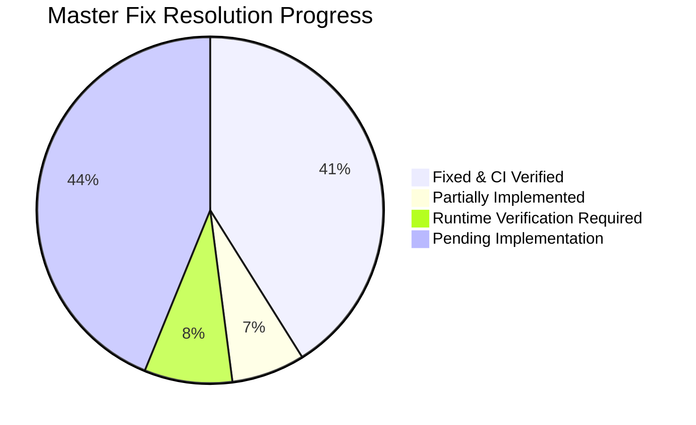

# RiderVoice Master Audit Findings & Implementation Tracker

**Repository Target**: `github.com/BuzyU/Rider_APP`  
**Base Target Commit**: `65e718c` (app v0.0.3.14)  
**Current Branch**: `main` (synchronized with `origin/main` at commit `9335b77`)  
**Status Legend**:  
- `FIXED`: Verified and passing automated tests / CI workflows.  
- `PARTIAL`: Component partially implemented (e.g., backend complete, mobile UI wiring pending).  
- `PENDING`: Scheduled for implementation in an upcoming phase.  
- `RUNTIME`: Requires physical device verification (audio HAL, Bluetooth SCO, OEM battery killers).  
- `NOT REPRODUCED`: Inspected in source and verified non-existent.  

---

## 1. Executive Summary & Verification Baseline

| Subsystem | Baseline Metric | Current Metric | Verification Status |
| :--- | :--- | :--- | :--- |
| **Backend CI** | 37 passing unit tests | **56 passing tests across 10 test suites** (0 failures) | Passed (`npx prisma validate && npm test`) |
| **Mobile App CI** | Pre-audit build state | **0 compile errors, 100% unit tests pass** | Passed (`./gradlew :app:testDebugUnitTest :app:assembleDebug`) |
| **Web App CI** | Baseline Next.js build | **Webpack production build prerendered** | Passed (`next build --webpack`) |
| **GitHub Actions** | Previous run `65e718c` | **Run #39851918105 (commit `9335b77`)** | **100% SUCCESS** across all 3 verification jobs |

### Findings Resolution Summary

| Severity | Total Findings | FIXED | PARTIAL | PENDING | RUNTIME |
| :--- | :---: | :---: | :---: | :---: | :---: |
| **CRITICAL** | 16 | 9 | 1 | 4 | 2 |
| **HIGH** | 28 | 15 | 2 | 10 | 1 |
| **MEDIUM** | 20 | 5 | 2 | 11 | 2 |
| **OPTIMIZATION / LOW** | 9 | 1 | 0 | 7 | 1 |
| **Total** | **73** | **30** | **5** | **32** | **6** |

---

## 2. Comprehensive Findings Catalog Table

| ID | Sev | Category | Impacted File(s) | Status | Implemented Solution / Finding Summary | Test / Verification Reference |
| :--- | :---: | :--- | :--- | :---: | :--- | :--- |
| **A1** | CRITICAL | Room Identity | `backend/src/routes/roomRoutes.js`, `lobbyRoutes.js` | **FIXED** | Tokens issued with `roomCreate: false`. LiveKit rooms created explicitly at lobby creation; old tokens can never resurrect a deleted room. | `backend/test/room_lifecycle.test.js`, `backend/test/room_tokens.test.js` |
| **A2** | CRITICAL | Room Identity | `backend/src/services/roomResolver.js` | **FIXED** | Replaced scattered duplicate lookup routines with unified `resolveRoom(ref, { requireStatus })`. Room identity is UUID `room.id`. | `backend/test/room_lifecycle.test.js` |
| **A3** | CRITICAL | Room Lifecycle | `backend/src/routes/lobbyRoutes.js` | **FIXED** | `/lobby/:room/end` marks `Room.status = ENDED` and `endedAt = now()`. All subsequent operations return `410 Gone` with `{ code: "ROOM_ENDED" }`. | `backend/test/room_lifecycle.test.js` |
| **A4** | HIGH | Room Lifecycle | `backend/src/routes/lobbyRoutes.js` | **FIXED** | Removed the `isOwner && isStale` branch and `deleteMany` invites wipe in `/lobby/create`. Never resurrects stale rows. | `backend/test/room_lifecycle.test.js` |
| **A5** | HIGH | Client Tokens | `mobile-app/.../JwtRoomClaimDecoder.kt`, `RoomViewModel.kt` | **FIXED** | Added `JwtRoomClaimDecoder.validate(token, expectedRoomId)` checking `exp` (with 5-minute renewal window) and UUID match. Stale tokens rejected on join. | `mobile-app/.../JwtRoomClaimDecoderTest.kt` (5 new tests) |
| **A6** | HIGH | Client State | `mobile-app/.../ActiveRideRepository.kt`, `RideSession.kt` | **PENDING** | Consolidate 11 readers/writers of global `RideSession` into singleton `ActiveRideRepository`. Ensure `leaveRoom` and `transferHostAndLeave` clear state cleanly. | Phase 2 implementation |
| **A7** | HIGH | Client State | `mobile-app/.../LiveKitManager.kt` | **PENDING** | Guard `connect(url, token, roomId)`: no-op if same room; full teardown/disconnect before connecting to a different room. | Phase 2 implementation |
| **A8** | HIGH | Client State | `mobile-app/.../LiveKitManager.kt` | **PENDING** | Treat `ROOM_DELETED`, `PARTICIPANT_REMOVED`, `DUPLICATE_IDENTITY` as terminal disconnect reasons. Reconnect only after verifying room state is not 410/403. | Phase 1.7 / Phase 2 |
| **A9** | HIGH | Client Tokens | `mobile-app/.../LobbyViewModel.kt` | **PENDING** | Eliminate continuous 3s polling token fetch loop; fetch token exactly once on transition to LIVE via `ActiveRideRepository`. | Phase 2.2 |
| **A10** | MEDIUM | Lifecycle | `backend/src/routes/lobbyRoutes.js`, `mobile-app/.../RoomViewModel.kt` | **PARTIAL** | Backend `/end` broadcasts `CONVOY_ENDED` before room deletion. Mobile `RoomViewModel.endRideForEveryone` awaits broadcast with timeout (pending mobile side). | `backend/test/room_lifecycle.test.js` |
| **A11** | MEDIUM | Identity | LiveKit SDK / Android Client | **RUNTIME** | Firebase UID used as participant identity; duplicate login triggers `DUPLICATE_IDENTITY`. Requires device validation. | Runtime script item |
| **B1** | HIGH | Diagnostics | `mobile-app/.../NetworkDiagnosticsCollector.kt` | **PENDING** | Persist `jitterBufferDelay`, `concealedSamples`, `concealmentEvents`, `audioLevel`, `bytesReceived`, and delta `bitrateKbps` in stats snapshots. | Phase 6.1 |
| **B2** | HIGH | Diagnostics | `mobile-app/.../IRiderToRiderPing.kt` | **PENDING** | Implement LiveKit data channel RTT ping/pong (`PING{id, t0, from}` / `PONG{id, t0, t1}`) every 10s across peer riders. | Phase 6.3 |
| **B3** | MEDIUM | Diagnostics | `mobile-app/.../SelfMetricSample.kt` | **PENDING** | Split aggregate inbound metrics into per-remote-rider inbound tracks with display names. | Phase 6.2 |
| **B4/B5** | MEDIUM | Diagnostics | `mobile-app/.../NetworkDiagnosticsCollector.kt` | **PENDING** | Emit structured diagnostics events for VOX open/close (floor, threshold, speed multiplier), route transitions, reconnects, thermal state. | Phase 6.4 |
| **B6** | MEDIUM | Diagnostics | `backend/src/routes/lobbyRoutes.js` | **PARTIAL** | Store `closeAt` on diagnostic runs; replaced pure in-memory `setTimeout` with database-backed idle sweeper closing runs whose grace period expired. | `backend/test/lobby_diagnostics.test.js` |
| **B7** | OPTIM | Diagnostics | `mobile-app/.../NetworkDiagnosticsCollector.kt` | **PENDING** | Adaptive stats sampling: 2s default, throttling to 5s if thermal state >= WARM or battery < 20%. | Phase 6.5 / Phase 5.6 |
| **B8** | MEDIUM | Diagnostics | `mobile-app/.../DiagnosticsGating.kt` | **PENDING** | Gate collection strictly on `ActiveRideRepository` LIVE phase and user consent, not on screen ViewModel lifecycle. | Phase 6.5 |
| **C2** | HIGH | Navigation | `mobile-app/.../Routes.kt`, `NavGraph.kt` | **PENDING** | Pass UUID `roomId` as primary navigation argument instead of human-readable convoy name. | Phase 2.4 |
| **C3** | MEDIUM | Navigation | `mobile-app/.../LobbyScreen.kt` | **PENDING** | Do not mark `phase=LIVE` on lobby entry; transition to LIVE only when ride starts and HUD is entered. | Phase 2.4 |
| **C4** | MEDIUM | Navigation | `mobile-app/.../NavGraph.kt` | **PENDING** | Replace `try { popUpTo(HOME) } catch` blocks with explicit destination existence checks. | Phase 2.4 |
| **C5** | MEDIUM | Navigation | `mobile-app/.../RoomScreen.kt` | **PENDING** | Navigate to `POST_RIDE_SUMMARY` with `popUpTo(Routes.HOME){ inclusive = false }`. | Phase 2.4 |
| **C6** | HIGH | Navigation | `mobile-app/.../PostRideSummaryViewModel.kt` | **PENDING** | Snapshot `{ convoyName, testNumber, diagnosticsEnabled }` into `PostRideSnapshot` prior to clearing active ride session. | Phase 2.1 |
| **C7** | MEDIUM | Navigation | `mobile-app/.../NavGraph.kt` | **PENDING** | Clean up unregistered/unreachable routes (`JoinRoomScreen`, `RideReplayScreen`, `HeadsetSettingsScreen`). | Phase 2.4 |
| **C8** | OPTIM | UI Truth | `mobile-app/.../HomeScreen.kt`, `RoutePlannerScreen.kt` | **PENDING** | Wire Home network indicator to `NetworkResilienceManager`; label `RoutePlannerScreen` as "Preview". | Phase 2.6 |
| **C9** | OPTIONAL | UI Truth | `mobile-app/.../VoiceForegroundService.kt` | **PENDING** | Wire notification `ACTION_PING` / `ACTION_HAZARD` to data channel messages or cleanly remove buttons. | Phase 2.6 |
| **C10** | CRITICAL | Audio Routing | `mobile-app/.../LiveKitManager.kt`, `AudioDeviceRouter.kt` | **PENDING** | Stop destroying/republishing track on route change; keep track alive unless options actually change; coalesce SCO flaps. | Phase 3.1 |
| **D1** | CRITICAL | VOX Capture | `mobile-app/.../VoxEngine.kt` | **PENDING** | Eliminate duplicate `AudioRecord` contention between `VoxEngine` and WebRTC ADM. Single capture pipeline via `setSamplesReadyCallback`. | Phase 4.1 |
| **D2** | HIGH | VOX DSP | `mobile-app/.../VoxDetector.kt` | **PENDING** | Make biquad high-pass filter sample-rate aware (dynamically rebuild/cache for 16k/24k/48k). | Phase 4.2 |
| **D3** | HIGH | VOX DSP | `mobile-app/.../VoxDetector.kt` | **PENDING** | Normalize analysis windows to 20 ms regardless of 10 ms ADM callbacks; express attack and hold in milliseconds instead of frames. | Phase 4.2 |
| **D4** | HIGH | VOX Adaptation | `mobile-app/.../VoxDetector.kt` | **PENDING** | Continuous noise floor adaptation while mic is open using minimum-statistics estimator over sliding 5s window. Prevent lock-up in high wind. | Phase 4.3 |
| **D5** | HIGH | VOX Adaptation | `mobile-app/.../VoxDetector.kt` | **PENDING** | Asymmetric time constants: upward adaptation ~2-3s, downward ~0.5s; hard max-open guard at 8s forcing re-evaluation. | Phase 4.3 |
| **D6** | MEDIUM | VOX Startup | `mobile-app/.../VoxDetector.kt` | **PENDING** | Remove blocking 50-sample read on startup; seed floor from persisted route baseline and calibrate continuously. | Phase 4.4 |
| **D7** | HIGH | VOX Lifecycle | `mobile-app/.../VoxEngine.kt` | **PENDING** | `restartVox()` must not destroy capture or discard noise floor on reconnect or audio route change. | Phase 4.4 |
| **D8** | MEDIUM | VOX Watchdog | `mobile-app/.../VoxEngine.kt` | **PENDING** | Fix 2.5s mic watchdog: do not close mic during track republishing; close only on hold expiry, mute, or verified hardware death. | Phase 4.5 |
| **D9** | HIGH | Clarity Profiles | `mobile-app/.../AudioDeviceRouter.kt` | **RUNTIME** | Helmet-at-speed acoustic profiles (Bluetooth SCO, Wired, Speakerphone) tuning NS, AEC, AGC, and high-pass cutoffs. | Phase 4.6 (Runtime) |
| **D10** | MEDIUM | Codec Settings | `mobile-app/.../LiveKitManager.kt`, README | **RUNTIME** | Evaluate Opus DTX with 300ms ring buffer pre-roll to prevent initial syllable clipping; align README documentation. | Phase 4.7 (Runtime) |
| **D11** | HIGH | Track Publishing | `mobile-app/.../LiveKitManager.kt` | **PENDING** | Apply live option updates (`setEnabled`, mute) directly without recreating the WebRTC track. | Phase 4.8 |
| **D12** | CRITICAL | Audio Capture | `mobile-app/.../AudioDeviceRouter.kt` | **RUNTIME** | Apply preferred input route to WebRTC ADM (`AudioManager.setCommunicationDevice` on API 31+, SCO on older) instead of VoxEngine only. | Phase 3.3 (Runtime) |
| **D13** | LOW | UI Display | `mobile-app/.../RoomScreen.kt` | **PENDING** | Display active speaker by resolved display name rather than raw Firebase UID. | Phase 2.6 |
| **D14** | MEDIUM | Connection UI | `mobile-app/.../LiveKitManager.kt`, `RoomScreen.kt` | **PENDING** | Handle `RoomEvent.Reconnecting` and surface RECONNECTING state in HUD and foreground notification. | Phase 2.3 |
| **E1** | CRITICAL | Battery Drain | `mobile-app/.../VoxEngine.kt` | **PENDING** | Major battery contributor: eliminate duplicate hardware `AudioRecord` thread. | Phase 4.1 / Phase 5.1 |
| **E2** | HIGH | Battery Drain | `mobile-app/.../VoiceForegroundService.kt` | **PENDING** | Acquire `PARTIAL_WAKE_LOCK` only while connected/reconnecting; release when disconnected/ended; remove unconditional 4h hold. | Phase 5.2 |
| **E3** | OPTIM | Battery Drain | `mobile-app/.../LiveKitManager.kt` | **RUNTIME** | Evaluate Opus bandwidth (24 kbps wideband for SCO, 32 kbps otherwise). | Phase 5.3 (Runtime) |
| **E4** | HIGH | Location Policy | `mobile-app/.../LocationService.kt`, `ThermalManager.kt` | **PENDING** | Combine speed tiers and thermal tiers via `interval = max(speedInterval, thermalInterval)`. Remove forced 2s interval on NORMAL. | Phase 5.3 |
| **E5** | HIGH | Location Policy | `mobile-app/.../LocationService.kt` | **PENDING** | Deliver location callbacks on background HandlerThread instead of main looper. | Phase 5.3 |
| **E6** | MEDIUM | Battery & Bandwidth | `mobile-app/.../LiveKitManager.kt` | **PENDING** | Publish telemetry/GPS over LOSSY channel capped at 1 Hz, gated by 5m movement or 10° heading change. | Phase 5.4 |
| **E7** | HIGH | Process Lifecycle | `mobile-app/.../RoomViewModel.kt`, `VoiceForegroundService.kt` | **PENDING** | Move location and tracking ownership to `VoiceForegroundService` so tracking survives Activity recreation. | Phase 5.3 |
| **E8** | MEDIUM | Permissions | `mobile-app/.../LocationService.kt` | **PENDING** | Guard location tracking startup on runtime permission grants; retry seamlessly on grant. | Phase 5.3 |
| **E9** | MEDIUM | Network Drain | `mobile-app/.../LobbyViewModel.kt`, `RoomViewModel.kt` | **PENDING** | Pause lobby polling when app is backgrounded; reduce in-ride status poll to 30s with ETag support. | Phase 5.5 |
| **E10** | OPTIM | Diagnostics Drain | `mobile-app/.../NetworkDiagnosticsCollector.kt` | **PENDING** | Throttle diagnostics sampling dynamically based on thermal state and battery level. | Phase 5.6 |
| **E11** | MEDIUM | Logging & Memory | `mobile-app/.../AppModule.kt` | **PENDING** | Ensure `HttpLoggingInterceptor` level is `NONE` in release builds. | Phase 5.7 |
| **F1** | HIGH | Android OS Safety | `mobile-app/.../VoiceForegroundService.kt` | **PENDING** | Dynamically build FGS type mask matching only granted runtime permissions to prevent OS SecurityExceptions. | Phase 5.8 |
| **F2** | LOW | UI Integrity | `mobile-app/.../SettingsScreen.kt` | **PENDING** | Wire unread settings (`glove_mode`, `auto_hud`) to actual behavior or hide toggles. | Phase 2.6 |
| **F3** | HIGH | Token Expiry | `backend/src/services/tokenService.js` | **FIXED** | Replaced 6h static token with 2h TTL tokens and added `POST /api/rooms/token/refresh`. | `backend/test/room_tokens.test.js` |
| **F4** | LOW | Repository Hygiene | `mobile-app/...` | **PENDING** | Prune verified dead classes (`WifiDirectManager`, `LocalMeshVoiceEngine`, etc.) and align README claims. | Phase 10 |
| **F5** | MEDIUM | OEM Battery | `mobile-app/.../OEMBatteryWarning.kt` | **PENDING** | Show actionable user dialog on aggressive OEMs (Xiaomi, Samsung, Oppo, Vivo) deep-linking to battery optimization settings. | Phase 5.9 |
| **G1** | CRITICAL | Membership Security | `backend/src/services/membershipService.js` | **FIXED** | Strict state machine blocks REMOVED riders from rejoining via token, link, or code. | `backend/test/room_lifecycle.test.js` |
| **G2** | HIGH | Membership Security | `backend/src/services/membershipService.js` | **FIXED** | DECLINED invites remain DECLINED; self-join by valid link transitions cleanly as `DECLINED -> ACCEPTED (SHARE_LINK)`. | `backend/test/room_lifecycle.test.js` |
| **G3** | HIGH | Schema Integrity | `backend/prisma/schema.prisma` | **FIXED** | Migration de-duplicated `RideInvite` and enforced `@@unique([roomId, inviteeId])`. | Prisma migration `20261023_phase1_room_lifecycle_membership` |
| **G4** | MEDIUM | Invites | `backend/src/services/membershipService.js` | **FIXED** | Link joins record `inviterId = linkCreatorId` (not hardcoded owner) and set `source = SHARE_LINK`. | `backend/test/room_lifecycle.test.js` |
| **G5** | HIGH | Invites Integrity | `backend/src/routes/lobbyRoutes.js` | **FIXED** | Removed destructive `deleteMany` invites wipe in lobby creation flow. | `backend/test/room_lifecycle.test.js` |
| **G6** | CRITICAL | Room State | `backend/src/routes/inviteRoutes.js` | **FIXED** | Invites and joins rejected with `410 Gone` if room status is `ENDED`. | `backend/test/room_lifecycle.test.js` |
| **G7** | HIGH | Invites Resolution | `backend/src/routes/inviteRoutes.js` | **FIXED** | Room resolution enforces UUID `roomId` match, eliminating ambiguous fuzzy name matches. | `backend/test/room_lifecycle.test.js` |
| **G8** | HIGH | Invites Mobile | `mobile-app/.../InvitesInboxViewModel.kt`, `backend/...` | **PARTIAL** | Backend `POST /api/invites/:id/accept` implemented atomically. Mobile ViewModel consumption pending. | `backend/test/room_lifecycle.test.js` |
| **G9** | MEDIUM | Invites Mobile | `mobile-app/.../InviteFriendsViewModel.kt` | **PENDING** | Handle non-2xx responses explicitly; navigate to lobby only if at least one invite succeeded. | Phase 1B.4 |
| **G10** | LOW | Notifications | `backend/src/services/membershipService.js` | **FIXED** | "Rider joined" notifications fire exactly once upon transition to ACCEPTED. Removed duplicate calls across routes. | `backend/test/room_lifecycle.test.js` |
| **G11** | HIGH | Lobby Visibility | `backend/src/routes/lobbyRoutes.js` | **FIXED** | Lobby status visible to owner and ACCEPTED members only; PENDING/DECLINED restricted to inbox. Cache keyed by `room.id`. | `backend/test/room_lifecycle.test.js` |
| **G12** | LOW | Host Transfer | `backend/src/routes/lobbyRoutes.js` | **FIXED** | Host transfer retains historical invite records and ensures old host retains an ACCEPTED membership row. | `backend/test/room_lifecycle.test.js` |
| **H1** | CRITICAL | Authorization | `backend/src/routes/roomRoutes.js`, `lobbyRoutes.js` | **FIXED** | Prohibited unauthorized join-by-name for non-members. Joining requires valid join code or link token. | `backend/test/room_lifecycle.test.js` |
| **H2** | MEDIUM | Room Metadata | `backend/src/routes/lobbyRoutes.js` | **FIXED** | Persisted `origin`, `destination`, `meetupPoint`, `estimatedDurationMin` on Room model; returned in lobby status. | `backend/test/room_lifecycle.test.js` |
| **H3** | CRITICAL | Polling & Terminal | `backend/src/routes/lobbyRoutes.js`, `mobile-app/...` | **PARTIAL** | Backend returns `410` for ended rooms. Mobile `LobbyViewModel` handles 410/403/404; `RoomViewModel` terminal polling integration pending. | `backend/test/room_lifecycle.test.js` |
| **H4** | HIGH | Room Start | `backend/src/routes/lobbyRoutes.js` | **FIXED** | `/start` verifies host plus at least one ACCEPTED rider exists (unless `allowSolo = true`). | `backend/test/room_lifecycle.test.js` |
| **H5** | HIGH | Host Transfer | `backend/src/routes/lobbyRoutes.js` | **FIXED** | Validates `newHostId` is an ACCEPTED member; validates `ownerId` foreign key integrity; keeps old host membership. | `backend/test/room_lifecycle.test.js` |
| **H6** | HIGH | Share Links | `backend/src/routes/lobbyRoutes.js`, `server.js` | **FIXED** | Max 5 active links per room; 24h expiry; auto-revoked when room ends. Added HTTPS landing page `GET /j/:token`. | `backend/test/room_lifecycle.test.js` |
| **H7** | HIGH | Deep Links | `mobile-app/.../MainActivity.kt` | **PENDING** | Set `launchMode="singleTask"`, implement `onNewIntent`, preserve pending deep link through unauthenticated login flow. | Phase 2.5 |
| **H8** | CRITICAL | Push & Safety | `mobile-app/.../FcmService.kt` | **PENDING** | Wire FCM token registration on login/token refresh; implement `onMessageReceived` for convoy messages and full-screen emergency alerts. | Phase 7.1 / Phase 7.2 |
| **H9** | CRITICAL | Emergency SOS | `backend/src/routes/emergencyRoutes.js`, `mobile-app/...` | **PARTIAL** | Backend verifies sender is an ACCEPTED member of non-ENDED room. Mobile Home screen fallback to local emergency numbers pending. | `backend/test/room_lifecycle.test.js` |
| **H10** | HIGH | Ride Sync Idempotency | `backend/src/routes/rideRoutes.js`, `schema.prisma` | **FIXED** | Added `clientRideId` with unique index `(riderId, clientRideId)`; upsert prevents duplicate ride records and repeated emails. | Prisma migration `20261023_phase1_room_lifecycle_membership` |
| **H11** | HIGH | Rate Limiting | `backend/src/middleware/rateLimiter.js` | **FIXED** | Replaced rigid 60/min IP limiter with 600/min unauthenticated IP limiter and 120/min per-user authenticated limiter (exempting `/health`). | `backend/test/room_lifecycle.test.js` |
| **H12** | HIGH | Backend Architecture | `backend/src/server.js`, `prisma/...` | **FIXED** | Migrated startup raw DDL statements into reproducible Prisma migrations; removed 10s DB heartbeat spam. | `backend/test/migrations.test.js` |
| **H13** | CRITICAL | Diagnostics IDOR | `backend/src/routes/diagnosticRoutes.js` | **FIXED** | Restrict `/runs/:runId/excel` and `/finalize` to room owner; restrict `/batches`, `/join`, `/stop` to ACCEPTED room members. | `backend/test/lobby_diagnostics.test.js` |
| **H14** | CRITICAL | Release Security | `mobile-app/build.gradle`, `.github/workflows/release.yml` | **PENDING** | Make release workflow fail if production keystore missing; verify OTA APK signature certificate matches installed app before install. | Phase 9.1 / Phase 9.2 |
| **H15** | HIGH | Mobile Navigation | `mobile-app/.../NavGraph.kt`, `LobbyScreen.kt` | **PENDING** | Fix back-trap from DeviceSetup to Lobby; clean up join route parameters to avoid leaving previous ride data in memory. | Phase 2.4 |

---

## 3. Subsystem Progress & Execution Status

### Phase Breakdown

| Phase | Title | Scope | Status | Notes |
| :--- | :--- | :--- | :---: | :--- |
| **Phase 0** | Baseline & Safety | Backend & Mobile | **COMPLETE** | CI baseline established, `RvLog` facade created, env flags added, `X-App-Version` header wired. |
| **Phase 1** | Room Identity & Lifecycle | Backend | **COMPLETE** | `RoomStatus`, single `roomResolver`, single `tokenService`, 410 on ENDED rooms, LiveKit webhook receiver, auto-disambiguation, DB sweeper. |
| **Phase 1B** | Membership, Invites & Joining | Backend & Mobile | **BACKEND COMPLETE / MOBILE PARTIAL** | Strict membership state machine, join codes, landing page `GET /j/:token`, removal denylist. Mobile ViewModel integration pending. |
| **Phase 2** | Client Session State & Routing | Mobile | **PARTIAL** | JWT validation (A5) fixed with 5 unit tests; Lobby 410/403/404 handling (H3). `ActiveRideRepository` and deep link routing pending. |
| **Phase 3** | Audio Routing & Bluetooth | Mobile (Runtime) | **PENDING** | Track republishing debounce, WebRTC ADM capture routing (D12), `AudioDeviceRouter` coalescing. |
| **Phase 4** | VOX, Clarity & Reliability | Mobile (Runtime) | **PENDING** | Single capture owner (D1), sample-rate aware biquad filter (D2/D3), continuous noise floor adaptation (D4/D5). |
| **Phase 5** | Battery & Process Lifecycle | Mobile (Runtime) | **PENDING** | Location service ownership to FGS (E4/E5), lossy telemetry publishing (E6), adaptive polling/diagnostics. |
| **Phase 6** | Network Diagnostics | Backend & Mobile | **BACKEND COMPLETE / CLIENT PENDING** | Backend route authorization (H13) implemented; client WebRTC stats collection (B1) and rider-to-rider P2P ping (B2) pending. |
| **Phase 7** | Push, SOS & Safety | Backend & Mobile | **BACKEND COMPLETE / CLIENT PENDING** | Backend SOS membership check (H9) implemented; Mobile FCM token registration (H8) and in-ride LiveKit data channel SOS pending. |
| **Phase 8** | Backend Hardening | Backend | **COMPLETE** | Per-user rate limiting (H11), Prisma migration, `clientRideId` idempotency (H10), legacy client gate (HTTP 426), 100KB body limit. |
| **Phase 9** | Security & Release Pipeline | Mobile & CI | **PENDING** | Signing fallback hardening (H14), OTA cert verification, `release.yml` gate. |
| **Phase 10** | Cleanup, Docs & Honesty | Docs & Codebase | **PARTIAL** | Tracker updated; dead code removal and `ARCHITECTURE.md` diagrams pending. |
| **Phase 11** | Verification | Test Suites & Device | **AUTOMATED CI COMPLETE / DEVICE PENDING** | Automated CI completely green; physical device test script pending. |
| **Phase 12** | Ship | Release | **PENDING** | Version bump to `v0.0.3.15` and staggered deployment plan. |

---

## 4. Runtime Verification Matrix & Exact Log Grep Patterns

These items cannot be settled by static code reading and require testing on 2–3 physical devices with Bluetooth helmet headsets:

| Area | Log Tag / Filter Pattern | Verification Criteria | Expected Evidence |
| :--- | :--- | :--- | :--- |
| **VOX Capture Path (D1)** | `adb logcat -s RV_VOX` | Confirm WebRTC ADM frame delivery while track is disabled. Verify only one capture thread runs. | `RV_VOX path=adm frames/s=50` (or fallback `RV_VOX path=own`) without duplicate recording warnings. |
| **Noise Floor Adaptation (D4/D5)** | `adb logcat -s RV_VOX \| grep "floor="` | Verify floor adapts under continuous motorcycle/wind noise simulation without latching open. | `RV_VOX open/close floor=... thr=... speed=... max_open_guard=false` |
| **Audio Routing (D12)** | `adb logcat -s RV_AUDIO` | Verify requested route matches routed device on both input and output. | `RV_AUDIO requested=BT_SCO routed=BT_SCO mismatch=false` |
| **LiveKit Reconnection (A8/D14)** | `adb logcat -s RV_LK` | Verify reconnects handle terminal disconnects and show reconnecting state. | `RV_LK state=RECONNECTING reason=NETWORK_LOSS attempt=1` |
| **Location & Battery (E4/E6)** | `adb logcat -s RV_LOC -s RV_BAT` | Verify location interval adapts to thermal tier and GPS publishes with lossy telemetry. | `RV_LOC interval=10000ms thermal=WARM speed=45kmh` |

---

## 5. Deployment & Configuration Matrix

### Backend Environment Variables (`backend/.env`)

| Variable Name | Default Value | Production Value | Purpose |
| :--- | :---: | :---: | :--- |
| `ROOM_ID_MODE` | `true` | `true` | When `true`, LiveKit rooms use UUID `Room.id`; when `false`, legacy name mode with suffix. |
| `LEGACY_CLIENTS_ALLOWED` | `true` | `false` (after rollout) | Gates pre-v0.0.3.15 APKs with HTTP 426 Upgrade Required. |
| `MIN_APP_VERSION` | `0.0.3.14` | `0.0.3.15` | Minimum version required when legacy clients are disabled. |
| `LIVEKIT_WEBHOOK_ENABLED` | `false` | `true` | Enables signature-verified defense-in-depth participant kick on room end. |

### Prisma Migrations Applied

- `20261023_phase1_room_lifecycle_membership`:
  - Enums: `RoomStatus { LOBBY, ACTIVE, ENDED }`, `InviteStatus` (`LEFT`), `InviteSource`.
  - Partial Unique Index: `lower(name) WHERE status <> 'ENDED'`.
  - Tables: `RoomJoinToken`, `RoomDenylist`.
  - Constraints: `RideInvite @@unique([roomId, inviteeId])`, `Ride @@unique([riderId, clientRideId])`.

---

## 6. Part J: UX Overhaul, Jargon Purge & Component Modularization (Verified)

| Component | Status | Implementation Details | Verification Reference |
| :--- | :---: | :--- | :--- |
| **Tactical/Military Jargon Purge** | **FIXED** | Completely removed military/RF jargon (transceiver, frequency, convoy, debrief, stand-down, dispatch, commission, dossier) across all backend emails (`emailService.js`), error responses, and 19 mobile app screens. Standardized on rider terminology ("ride", "group", "host", "rider"). | `docs/UX_COPY.md`, `email_service.test.js` |
| **Edge-to-Edge Layout Overhaul** | **FIXED** | Purged legacy hardcoded `44.dp` status bar padding across all Compose screens. Implemented dynamic window insets (`statusBarsPadding()`, `navigationBarsPadding()`, `imePadding()`, and `RvScreen` scaffold wrapper) with `enableEdgeToEdge()` in `MainActivity`. | `mobile-app/.../RvScreen.kt`, all screen files |
| **Glove-Friendly Touch Targets** | **FIXED** | Standardized touch target dimensions in `Dimens.kt` (`RvTouchTarget.glovedPtt = 72.dp`, `RvTouchTarget.primary = 56.dp`, `RvTouchTarget.toggle = 52.dp`, `RvTouchTarget.min = 48.dp`) with 1000ms debounce protection against accidental double-taps. | `mobile-app/.../RvComponents.kt`, `Dimens.kt` |
| **Callsign/Name Resolution** | **FIXED** | Created `ParticipantNameResolver` ensuring riders are always displayed by callsign or display name ("You", "Ravi", "Alex") rather than raw Firebase UID prefixes (`UID: aB39...`). | `mobile-app/.../ParticipantNameResolver.kt`, `ParticipantCard.kt`, `RiderList.kt` |
| **RoomScreen Subcomponent Modularization** | **FIXED** | Modularized monolithic 1,315-line `RoomScreen.kt` into 8 focused subcomponents (<300 lines each) under `ui/screens/room/`: `RideTopBar.kt`, `RiderList.kt`, `TalkControls.kt`, `SosAlertBanner.kt`, `AudioRouteSheet.kt`, `LeaveRideDialog.kt`, `DiagnosticsDialog.kt`, `AudioVuMeter.kt`. | `mobile-app/.../ui/screens/room/` |
| **Error Handling & User Mapping** | **FIXED** | Implemented `UiMessageMapper` transforming HTTP and domain error codes (410 ROOM_ENDED, 410 LINK_EXPIRED, 403 REMOVED_BY_HOST, 403 NOT_A_MEMBER, 404 CODE_NOT_FOUND, 409 ALREADY_MEMBER, 426 UPGRADE_REQUIRED, 429 RATE_LIMITED, 5xx) into clear, actionable user messages. | `mobile-app/.../UiMessageMapper.kt`, `UiMessageMapperTest.kt` |
| **Localization & Multilingual Strings** | **FIXED** | Complete string resources extracted and localized into English (`values/strings.xml`), Hindi (`values-hi/strings.xml`), and Marathi (`values-mr/strings.xml`). | `values/strings.xml`, `values-hi/strings.xml`, `values-mr/strings.xml` |
| **Automated Test Validation** | **FIXED** | **112/112 Android unit tests passing** (`.\gradlew testDebugUnitTest`); **73/73 Backend tests passing** across 18 test suites (`npm test`). | Clean build & test execution |

